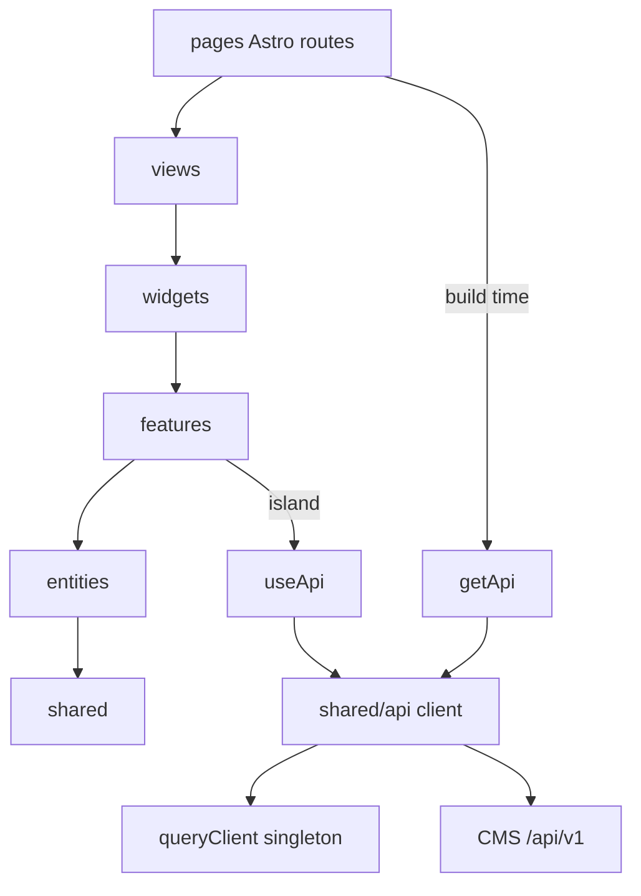

# Requirements

### Overview & Goals
Создать OpenSpec-изменение `standardize-frontend-architecture` (только артефакты: `proposal.md`, `specs/*/spec.md`, `design.md`, `tasks.md`; код не пишется). Цель изменения — привести pokodim.рф к единому стандарту:
- порядок в импортах и структуре папок (FSD, алиасы, лимит 150 строк на файл);
- единый слой доступа к CMS: один `useApi()` + TanStack Query, которым пользуются все React-острова; build-time код Astro берёт тот же клиент;
- единые лоадеры: кнопки, страницы/острова, сетка карточек;
- серверные фильтры и cursor-пагинация («Показать ещё») каталога;
- сложные компоненты — только React.

### Решения пользователя (зафиксированы)
- Рендер: **SSG + React-острова**. Страницы и SEO остаются статикой Astro; каталог, фильтры, поиск, «ещё», кнопки — React-острова.
- Каталог: **серверные фильтры + «Показать ещё»** (`useInfiniteQuery` по `cursor`; инструмент → `category`, уровень → `tag`; поиск по заголовку — на клиенте среди загруженных; первая страница приходит из SSG как `initialData`).

### Scope
**In scope**
- Аудит проекта и список критических проблем (см. ниже) в `proposal.md`.
- Спеки четырёх capability: `project-conventions`, `api-data-layer`, `catalog-data-loading`, `loading-states`.
- `design.md` с целевой структурой, контрактами `useApi()`, query keys, URL-состоянием, лоадерами.
- `tasks.md` с проверяемыми шагами внедрения.

**Out of scope**
- Реализация кода (стоп на `AWAITING CODE APPROVAL`).
- Новый дизайн, SEO-мета (OG/canonical/favicon), оплата, авторизация посетителей, заявки.
- Любой свой backend/CMS; локальный JSON как источник данных.
- Правки двух неархивированных изменений `add-mvp-home-catalog` и `polish-pokodim-visual-design`.

### Критические моменты, найденные в коде
1. **Потеря материалов.** `fetchPosts()` в `src/lib/cms.ts` читает только первую страницу (cursor игнорируется) и используется на `index.astro`, `materials/index.astro`, `getStaticPaths` в `materials/[slug].astro`; лишь `fetchPostsByParams` ходит по cursor. Материалы со 2-й страницы CMS не попадут на сайт и не получат страниц.
2. **Тихие отказы.** Ошибки/401/отсутствие env превращаются в `[]` + `console.warn`; CI с неверными секретами собирает пустой каталог и остаётся зелёным. Нужен fail-fast на сборке и error-состояние в UI.
3. **Три копии сетевого кода** в `cms.ts` (`requestJson`, `fetchPosts`, `fetchPostsByParams`): нет таймаута, `AbortSignal`, обработки `429/503 Retry-After`, разбора конверта `{error:{code,...}}`.
4. **Каталог на DOM-хаках.** Фильтры/поиск — два inline-`<script>` (`FilterBar.astro`, `SearchBox.astro`) + `lib/catalog-client.ts` через `data-*` и `hidden`. Нет пагинации, состояния загрузки/ошибки, тестируемости.
5. **Хрупкие выводы.** Инструмент берётся из `post.path.split('/')[2]` (`MaterialCard.astro`); уровни — захардкоженный `LEVELS` в `lib/catalog.ts`.
6. **Env.** `import.meta.env.BACKEND_KEY as string | undefined` без схемы; в браузер ключ не попадёт. Нужна схема `astro:env` (`context: client`, `access: public`) с теми же именами `BACKEND_API`/`BACKEND_KEY` и проверкой, что ключ публичный (`pk_…`). Текущий ключ в `.env` — `pk_live_…` (значение не выводится), `.env` в `.gitignore`.
7. **Свой Markdown-рендер** (`lib/markdown.ts`) + `set:html`: ручной парсер без тестов; экранирование есть, но поддержка/XSS-риск растут. Решение: покрыть тестами или заменить проверенной библиотекой.
8. **Структура и стиль.** Относительные импорты `../../lib/...`, нет алиасов, нет ESLint/Prettier/тестов (CI: только `astro check` + build), захардкоженные цвета в `.astro`/`.css` (например `#303a49`) при наличии токенов; `[slug].astro` ровно 150 строк, `design.css` 148, `home-hero.css` 146 — на пределе лимита.
9. **Локаль** `'ru'` зашита в нескольких местах.
10. **Пакет `@cms/api-client`**: реестр GitLab отвечает `401` без токена — доступ не проверен.

### Functional Requirements (для спеков)
- **project-conventions:** слои FSD (`app`, `views`, `widgets`, `features`, `entities`, `shared`; Astro-роуты в `src/pages` тонкие), алиасы `@/*`, запрет относительных импортов через слои, порядок импортов, ≤150 строк на файл (ts/tsx/astro/css), все конфиги — в `src/shared/config/*.ts`, интерактивные/сложные компоненты — `.tsx`, `.astro` — только статическая обвязка, ESLint/`astro check`/build в CI.
- **api-data-layer:** единый клиент (`@cms/api-client` либо тонкий транспорт с тем же интерфейсом); `useApi()` — единственная точка доступа React-кода к API; запросы `fetch` вне `shared/api` запрещены; заголовок `X-Api-Key`; ошибки конверта → `ApiError`; `429/503` с `Retry-After` — повтор; в браузере только `public`-ключ; `/api/admin/v1/*` не вызывается; на сборке отсутствие env/401/пустой ответ — ошибка сборки.
- **catalog-data-loading:** `useInfiniteQuery` по `cursor`, кнопка «Показать ещё» (скрыта без `next_cursor`), фильтры инструмент/уровень в URL (`?tool=&level=&q=`), восстановление из URL, серверные `category`/`tag`, `initialData` из SSG, сохранение предыдущего списка при смене фильтра (`placeholderData`), пустое состояние и состояние ошибки с «Повторить».
- **loading-states:** `Button` с `loading` (spinner, `aria-busy`, `disabled`, без скачка ширины), `Spinner`, `Skeleton`/`CardSkeleton`, `PageLoader` для островов и глобальная полоса прогресса (`useIsFetching` + клик по внутренним ссылкам); `prefers-reduced-motion` учитывается.

### Non-Functional Requirements
- CI push → выкат ≤ 10 минут (кэш `node_modules` по `package-lock.json` уже есть).
- Доступность: `aria-busy`, `role=status`, фокус не теряется при подгрузке.
- JS только там, где нужна интерактивность (`client:load`/`client:visible`).

# Technical Design

### Current Implementation
- Astro `^7.3.6`, TypeScript `^6.0.3`, чистый SSG (`astro.config.mjs` пустой, `dist/` статический). React, TanStack Query, ESLint, тестов нет.
- Данные: `src/lib/cms.ts` (типы `Post`, `Category` + три функции fetch), `src/lib/catalog.ts` (хелперы, `LEVELS`), `src/lib/catalog-client.ts` + inline-скрипты в `FilterBar.astro`/`SearchBox.astro`.
- Страницы: `pages/index.astro`, `pages/materials/index.astro`, `pages/materials/[slug].astro`, `pages/404.astro`; компоненты `SiteNav`, `MaterialCard`, `FilterBar`, `SearchBox`; стили `src/styles/*.css`.
- Контракт CMS (`https://backend.w1do.ru/LLM.txt`, проверен): `GET /api/v1/content/posts` (`locale`, `category`, `tag`, `cursor`; нет `per_page` и серверного поиска), `GET /api/v1/content/categories`, конверт `{data, meta.next_cursor}` / `{error:{code,message,details,trace_id}}`, `429/503` + `Retry-After`; ключ `public` допустим в браузере, CORS открыт.

### Key Decisions
1. **SSG + React-острова** (выбор пользователя). Контекст React не шарится между островами → один модульный синглтон `queryClient` в `shared/api/query-client.ts`, каждый остров оборачивается в `<AppProviders>` (`app/providers`).
2. **Один источник API.** `shared/api/client.ts` экспортирует `getApi()` (синглтон, для build-time Astro) и `useApi()` (хук, возвращает тот же объект). Все query-хуки (`useMaterialsInfinite`, `useTools`) получают клиент только через `useApi()`.
3. **Клиент.** Предпочтительно `@cms/api-client/public` (`createClient({ baseUrl, apiKey })`). Реестр отвечает 401 — **допущение, требует подтверждения:** если доступа/токена нет, `shared/api/transport.ts` (≈50 строк на `fetch`) реализует тот же интерфейс `Api`, замена локальна. Токен реестра — только через env/`.npmrc` вне git.
4. **Env.** `astro.config.mjs` → `env.schema` (`BACKEND_API`, `BACKEND_KEY`: `envField.string({context:'client', access:'public'})`), чтение через `astro:env/client` в одном файле `shared/config/env.ts` с проверкой префикса `pk_`. Имена переменных не меняются.
5. **Пагинация.** `useInfiniteQuery`, `initialPageParam: null`, `getNextPageParam: p => p.meta.next_cursor ?? undefined`; ключ `['materials', {locale, category, tag}]`; поиск `q` не входит в ключ (клиентский фильтр по `title`/описанию загруженных).
6. **Лоадеры** — компоненты `shared/ui`, глобальная полоса — `widgets/page-progress`.
7. **FSD в Astro:** `src/pages` оставлен роутингом Astro; FSD-слой страниц называется `src/views`.
8. **Качество:** ESLint (`typescript-eslint`, `eslint-plugin-astro`, `react-hooks`, `import`), правила `max-lines: 150`, `no-restricted-imports` (относительные `../`), `no-restricted-syntax` для `fetch`/`import.meta.env` вне `shared`; Vitest для чистой логики.

### Architecture Diagram


### File Structure
```
src/
  app/        layouts/BaseLayout.astro, providers/AppProviders.tsx, styles/
  pages/      index.astro, materials/index.astro, materials/[slug].astro, 404.astro  (тонкие)
  views/      home/, catalog/, material/
  widgets/    site-nav/, site-footer/, catalog-browser/, material-grid/, page-progress/
  features/   catalog-filters/, catalog-search/, load-more/
  entities/   material/ {api,model,ui}, tool/ {api,model}
  shared/     api/ {client,transport,errors,query-client,useApi}
              config/ {env,site,levels}.ts
              ui/ {Button,Spinner,Skeleton,PageLoader,Chip}
              lib/ {markdown,date,url-state}
```
Удаляются: `src/lib/cms.ts`, `catalog.ts`, `catalog-client.ts`, inline-скрипты `FilterBar`/`SearchBox` (заменяются React). `tsconfig.json`: `"paths": {"@/*": ["src/*"]}`, `jsx: react-jsx`.

### Data Models / Contracts
```ts
interface Api {
  posts: { list(p: {locale?: string; category?: number; tag?: string; cursor?: string|null}, o?: {signal?: AbortSignal}): Promise<Page<Post>>;
           bySlug(slug: string, locale?: string): Promise<Post> };
  categories: { list(): Promise<Category[]> };
}
type Page<T> = { data: T[]; meta: { next_cursor: string | null } };
class ApiError extends Error { code: string; status: number; details?: unknown; traceId?: string; retryAfter?: number }

function useApi(): Api;          // shared/api/useApi.ts
function getApi(): Api;          // build-time
function useMaterialsInfinite(filters: CatalogFilters, initial?: Page<Post>): UseInfiniteQueryResult;
function useCatalogUrlState(): [CatalogFilters, (patch: Partial<CatalogFilters>) => void]; // ?tool&level&q
```
Build-time: `getAllPosts()` в `entities/material/api` обходит все cursor-страницы (с лимитом-предохранителем и ошибкой при его превышении); любой не-2xx/пустой результат при наличии env → `throw`.

### Risks
- **Доступ к `@cms/api-client`** (401) — fallback на `transport.ts`; решение зафиксировать в `design.md`.
- **Astro 7 / `@astrojs/react` 7.0.1:** Context7 содержит документацию Astro 6.3.1 — `astro:env`, `client:*` проверены по общим докам; совместимость 7.x проверить на `npm install` (peer `oxc-transform-react`, React 19.3.0, `@tanstack/react-query` 5.104.1 — версии из `npm view`).
- **Гидрация:** `initialData` из SSG должен совпадать по ключу и `staleTime`, иначе лишний refetch и мигание; SSR-разметка острова = скелетон/первая страница без расхождений.
- **Фильтр «инструмент → category id»:** требует загруженных категорий; на SSG прокидываются в props.
- **Поиск только по загруженным** постам — ограничение CMS (серверного поиска нет); отразить в спеке.
- **Две неархивированные change** (`add-mvp-home-catalog`, `polish-pokodim-visual-design`) описывают текущее поведение; main-спек пуст, поэтому новые capability — ADDED, без MODIFIED.
- Рефакторинг трогает все файлы: делать слоями, на каждом шаге `astro check` + build.

# Testing

### Validation Approach
Проверки выполняются на этапе реализации после явного одобрения кода; для текущей задачи — валидация артефактов.

### Key Scenarios
- `openspec validate standardize-frontend-architecture` и `openspec status --change standardize-frontend-architecture` — все артефакты `done`, у каждого требования есть `#### Scenario`.
- (реализация) `npm run lint`, `npx astro check`, `npm run build` проходят; `dist/` содержит страницы всех материалов (число = сумма по всем cursor-страницам).
- (реализация) сборка с неверным `BACKEND_KEY` или пустым ответом падает.
- (реализация) Vitest: сборка параметров `category`/`tag` из фильтров, `getNextPageParam`, парсинг/запись URL-состояния, `ApiError` из конверта, повтор по `Retry-After`.
- (реализация) ста��ические проверки: нет `fetch(`/`import.meta.env` вне `shared/api`/`shared/config`, нет `../`-импортов между слоями, нет файлов >150 строк.

### Edge Cases
- нет `next_cursor` → кнопка «Показать ещё» скрыта; фильтр без результатов → пустое состояние; ошибка сети → error + «Повторить»; быстрая смена фильтров → отмена по `AbortSignal`; `prefers-reduced-motion`; открытие URL с `?tool=…&level=…`.

### Test Changes
Добавляются Vitest-тесты чистой логики и шаг `npm run lint` + `npm test` в `.github/workflows/ci.yml` (в пределах 10 минут).

# Delivery Steps

### ✓ Step 1: Создать change и написать proposal.md
Создан change `standardize-frontend-architecture` и готов `proposal.md` с аудитом проблем.

- `openspec new change "standardize-frontend-architecture"` и `openspec status --change ... --json` для порядка артефактов.
- Прочитать `openspec instructions proposal ...`, использовать шаблон; язык — русский, как в существующих изменениях.
- Описать Why / What Changes / Capabilities (`project-conventions`, `api-data-layer`, `catalog-data-loading`, `loading-states`) / Impact.
- Включить 10 критических находок аудита (потеря постов из-за `fetchPosts`, тихие отказы, дубли сетевого кода, DOM-фильтры, хрупкий вывод инструмента/уровня, env, markdown, структура/линтеры, локаль, доступ к `@cms/api-client`).
- Зафиксировать решения: SSG + React-острова, серверные фильтры + «Показать ещё».

### ✓ Step 2: Написать delta-спеки четырёх capability
Созданы `specs/<capability>/spec.md` для четырёх capability в формате ADDED Requirements со сценариями.

- `project-conventions`: слои FSD (`views` вместо FSD-`pages`), алиас `@/*`, порядок импортов, лимит 150 строк, конфиги в `shared/config`, сложные компоненты на React, линт/проверки в CI.
- `api-data-layer`: единый клиент и `useApi()`/`getApi()`, запрет `fetch`/`import.meta.env` вне `shared`, `X-Api-Key` с публичным ключом, `ApiError`, повтор по `Retry-After`, fail-fast сборки, запрет `/api/admin/v1/*`.
- `catalog-data-loading`: `useInfiniteQuery` по cursor, «Показать ещё», серверные `category`/`tag`, URL-состояние, `initialData` из SSG, пустое состояние и ошибка с «Повторить», клиентский поиск по загруженным.
- `loading-states`: `Button loading`, `Spinner`, `CardSkeleton`, `PageLoader`, глобальная полоса прогресса, доступность и `prefers-reduced-motion`.
- Использовать только ADDED (main-спек пуст).

### ✓ Step 3: Написать design.md
Готов `design.md` с целевой архитектурой �� контрактами.

- Контекст и текущие проблемы; цели / не-цели.
- Решения: SSG + острова с синглтоном `queryClient` и `<AppProviders>`, `useApi()`/`getApi()`, выбор `@cms/api-client` vs `transport.ts` (допущение по 401 реестра), `astro:env` схема с проверкой `pk_`, `useInfiniteQuery`, `src/views` вместо FSD-`pages`, ESLint-правила (`max-lines`, `no-restricted-imports`, `no-restricted-syntax`).
- Целевое дерево `src/`, контракты `Api`, `ApiError`, `useMaterialsInfinite`, `useCatalogUrlState`, mermaid-диаграмма слоёв.
- Документальные свидетельства: Context7 Astro (docs; Astro 7 — пробел), TanStack Query v5.90.3; версии пакетов из `npm view`.
- Риски и план миграции по слоям.

### ✓ Step 4: Написать tasks.md и провалидировать change
Готов `tasks.md` и change проходит валидацию; работа остановлена на `AWAITING CODE APPROVAL`.

- Группы задач с чекбоксами и проверкой в каждой: 1) инструменты и каркас (React, `@astrojs/react`, TanStack Query, ESLint, Vitest, алиасы, `astro:env`); 2) `shared/api` (клиент, `useApi`, ошибки, fail-fast сборка); 3) `shared/ui` лоадеры; 4) миграция по слоям entities→features→widgets→views→pages, удаление `src/lib/*`; 5) каталог (`useInfiniteQuery`, URL-состояние, «Показать ещё», пустое/ошибка); 6) markdown (тесты или замена) и стили (токены вместо hex, лимит 150 строк); 7) CI (`lint`, `test`, `astro check`, `build`) и финальная проверка.
- Запустить `openspec validate standardize-frontend-architecture` и `openspec status --change standardize-frontend-architecture`.
- Сообщить итог и ждать явной команды `/opsx-apply`; код не писать.