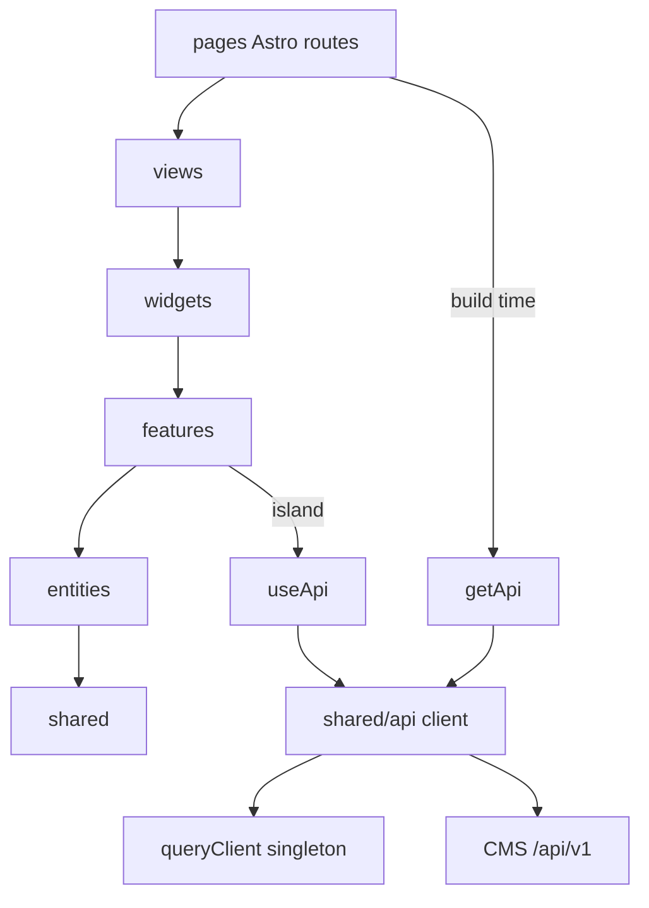

## Context

Мотивация и аудит — в `proposal.md`, требования — в `specs/*/spec.md`. Текущее состояние:

- Astro `^7.3.6`, TypeScript `^6.0.3`, чистый SSG (`astro.config.mjs` пустой, `dist/` статический). React, TanStack Query, ESLint, тестов нет.
- Данные: `src/lib/cms.ts` (типы + три функции fetch), `src/lib/catalog.ts` (хелперы, `LEVELS`), фильтры и поиск — inline-скрипты `FilterBar.astro`/`SearchBox.astro` + `lib/catalog-client.ts`.
- Контракт CMS (`https://backend.w1do.ru/LLM.txt`, проверен): `GET /api/v1/content/posts` (`locale`, `category`, `tag`, `cursor`; без серверного поиска), `GET /api/v1/content/categories`, конверт `{data, meta.next_cursor}` / `{error:{code,message,details,trace_id}}`, `429/503` + `Retry-After`; `public`-ключ допустим в браузере, CORS открыт.
- CI: `npm ci`, `astro check`, `build`; ограничение — push → выкат ≤ 10 минут.

Документальные свидетельства:

- Astro: Context7 `/withastro/docs` (`envField`, `astro:env/client`, `client:load`, общий клиентский стор между островами). Версия Astro 7 в Context7 отсутствует (есть 6.3.1) — **пробел**, совместимость проверить при `npm install`.
- TanStack Query: Context7 `/tanstack/query/v5.90.3` (`useInfiniteQuery` с `initialPageParam`/`getNextPageParam`, `placeholderData`, `useIsFetching`). Актуальная версия из `npm view` — `5.104.1` (в пределах v5).
- Версии из `npm view`: `@astrojs/react` 7.0.1 (peer: react/react-dom 17–19, `oxc-transform-react ^0.145.0`), `react` 19.3.0, `eslint` 10.12.0.
- `@cms/api-client`: `npm view` по реестру GitLab → `E401`, доступ **не подтверждён**.

## Goals / Non-Goals

**Goals:**
- Один слой доступа к CMS для островов и build-time кода; один синглтон `queryClient`.
- Слои FSD с проверяемыми линтером границами; тонкие маршруты Astro.
- Каталог на React-острове с серверными фильтрами и cursor-пагинацией; первая страница из SSG.
- Общие компоненты загрузки; доступность и `prefers-reduced-motion`.
- Автоматические проверки в CI без выхода за 10 минут.

**Non-Goals:**
- SSR/адаптеры, переход на «всё в React-островах», нумерованные страницы.
- Новый дизайн, SEO-мета, поиск на сервере, свой backend/кэш, локальный JSON.
- Правка активных изменений `add-mvp-home-catalog` и `polish-pokodim-visual-design`.

## Decisions

### D1. SSG + React-острова с общим синглтоном `queryClient`
Страницы и SEO остаются статикой Astro. Контекст React не делится между островами, поэтому `queryClient` — модульный синглтон в `shared/api/query-client.ts`, а каждый остров оборачивается в `<AppProviders>` (`app/providers`), передающий этот же экземпляр. Кэш общий для всех островов страницы.
*Альтернативы:* всё на `client:only` (плохо для SEO материалов); Astro SSR (адаптер, смена деплоя на Dokploy); общий стор (Nano Stores) — лишний слой рядом с TanStack Query.

### D2. Один источник API: `getApi()` и `useApi()`
`shared/api/client.ts` создаёт синглтон клиента; `getApi()` отдаёт его build-time коду Astro, `useApi()` (`shared/api/useApi.ts`) — React-коду, это тот же объект. Query-хуки (`useMaterialsInfinite`, `useTools`) получают клиент только через `useApi()`. Хук делает клиент заменяемым в тестах через провайдер.
*Альтернатива:* вызывать `fetch` в хуках — отвергнуто (дубли, нет единой обработки ошибок).

### D3. Реализация клиента: `@cms/api-client` либо `shared/api/transport.ts`
Предпочтителен `@cms/api-client/public` (`createClient({ baseUrl, apiKey })`), как рекомендует CMS. Реестр отвечает `401`, поэтому **допущение, требующее подтверждения при реализации:** если токен реестра недоступен, `shared/api/transport.ts` (≈50 строк на `fetch`, `AbortSignal`, таймаут, разбор конверта, повтор по `Retry-After`) реализует тот же интерфейс `Api`. Остальной код зависит только от интерфейса, замена локальна. Токен реестра — только через env/`.npmrc` вне git; в CI — секрет.

### D4. Env через схему `astro:env`
В `astro.config.mjs`: `env.schema` с `BACKEND_API` и `BACKEND_KEY` как `envField.string({ context: 'client', access: 'public' })`. Чтение — только через `astro:env/client` в `shared/config/env.ts`, который проверяет наличие значений и префикс `pk_`, иначе бросает ошибку (fail-fast). Имена переменных не меняются. Значение ключа не логируется.
*Альтернатива:* `import.meta.env.BACKEND_KEY` — нет схемы и типов, ключ не попадает в браузерный код.

### D5. Пагинация: `useInfiniteQuery` по `cursor`
`initialPageParam: null`, `getNextPageParam: (p) => p.meta.next_cursor ?? undefined`. Ключ `['materials', { locale, category, tag }]`; поиск `q` в ключ не входит и фильтрует `title`/описание уже загруженных карточек. `placeholderData: keepPreviousData` сохраняет список при смене фильтра. Первая страница без фильтров приходит из SSG как `initialData` (с `initialPageParam: null`); одинаковые ключ и `staleTime` исключают лишний refetch после гидрации. `signal` из `queryFn` передаётся в клиент для отмены.

### D6. Фильтры и URL-состояние
`useCatalogUrlState()` читает/пишет `?tool=&level=&q=` через `history.replaceState`/`URLSearchParams` (без перезагрузки). `tool` — slug категории → `category` (id) по списку категорий, прокинутому в props с SSG; `level` → `tag` из списка уровней в `shared/config/levels.ts`. Неизвестные значения игнорируются. Парсинг/сериализация — чистые функции в `shared/lib/url-state` (покрываются Vitest).

### D7. Слои FSD и `src/views`
`src/pages` остаётся роутингом Astro, FSD-слой страниц называется `src/views`.
```
src/
  app/        layouts/BaseLayout.astro, providers/AppProviders.tsx, styles/
  pages/      index.astro, materials/index.astro, materials/[slug].astro, 404.astro  (тонкие)
  views/      home/, catalog/, material/
  widgets/    site-nav/, site-footer/, catalog-browser/, material-grid/, page-progress/
  features/   catalog-filters/, catalog-search/, load-more/
  entities/   material/ {api,model,ui}, tool/ {api,model}
  shared/     api/ {client,transport,errors,query-client,useApi}
              config/ {env,site,levels}.ts
              ui/ {Button,Spinner,Skeleton,PageLoader,Chip}
              lib/ {markdown,date,url-state}
```
Удаляются: `src/lib/cms.ts`, `catalog.ts`, `catalog-client.ts`, inline-скрипты `FilterBar`/`SearchBox`. `tsconfig.json`: `"paths": {"@/*": ["src/*"]}`, `"jsx": "react-jsx"`.



### D8. Контракты
```ts
interface Api {
  posts: {
    list(p: { locale?: string; category?: number; tag?: string; cursor?: string | null },
         o?: { signal?: AbortSignal }): Promise<Page<Post>>;
    bySlug(slug: string, locale?: string): Promise<Post>;
  };
  categories: { list(): Promise<Category[]> };
}
type Page<T> = { data: T[]; meta: { next_cursor: string | null } };
class ApiError extends Error {
  code: string; status: number; details?: unknown; traceId?: string; retryAfter?: number;
}
function useApi(): Api;      // shared/api/useApi.ts
function getApi(): Api;      // build-time
function useMaterialsInfinite(filters: CatalogFilters, initial?: Page<Post>): UseInfiniteQueryResult;
function useCatalogUrlState(): [CatalogFilters, (patch: Partial<CatalogFilters>) => void];
```
Build-time `getAllPosts()` в `entities/material/api` обходит все cursor-страницы с предохранительным лимитом (превышение — ошибка); любой не-2xx или пустой результат → `throw`.

### D9. Лоадеры
Компоненты в `shared/ui`: `Button` (`loading` → spinner, `aria-busy`, `disabled`, ширина фиксируется через невидимую подпись-плейсхолдер), `Spinner` (`role="status"`), `Skeleton`/`CardSkeleton` (те же размеры, что у карточки), `PageLoader` для островов. Глобальная полоса — `widgets/page-progress`: `useIsFetching` + слушатель кликов по внутренним ссылкам, гасится по `pageshow`/смене страницы. CSS-анимации отключаются через `@media (prefers-reduced-motion: reduce)`. Цвета — токены из `app/styles`, не hex.

### D10. Автоматические проверки
ESLint (`typescript-eslint`, `eslint-plugin-astro`, `react-hooks`, `import`): `max-lines: 150`; `no-restricted-imports` для `../*`; `no-restricted-syntax` для `fetch` и `import.meta.env` вне `shared/api`/`shared/config`; границы слоёв через `import/no-restricted-paths` (либо `eslint-plugin-boundaries`); порядок через `import/order`. Vitest — только чистая логика. В CI: `lint → test → astro check → build`; кэш `node_modules` по `package-lock.json` уже есть.
*Альтернатива:* только Prettier/ручное ревью — не проверяемо в CI.

### D11. Markdown
`shared/lib/markdown` переносится как есть и покрывается тестами (экранирование HTML, схемы ссылок, код-блоки); замена на проверенную библиотеку допустима отдельным решением, если тесты покажут недостаточность. До этого `set:html` остаётся только для результата этой функции.

## Risks / Trade-offs

- **Нет доступа к `@cms/api-client`** (401) → fallback `transport.ts` за тем же интерфейсом `Api`; подтвердить токен до начала группы задач про клиент.
- **Astro 7 / `@astrojs/react` 7.0.1** не покрыты Context7 (только 6.3.1) → проверить `astro:env`, `client:*` и peer `oxc-transform-react` на `npm install` и первой сборке.
- **Гидрация:** расхождение `initialData` и ключа/`staleTime` даёт лишний refetch и мигание → единый конфиг `queryKeys`/`staleTime`, SSR-разметка острова = первая страница.
- **Фильтр «инструмент → category id»** зависит от категорий → прокидываются в props с SSG; нет категорий — фильтр скрыт, остальной каталог работает.
- **Поиск только по загруженным** (в CMS нет серверного поиска) → явное поведение в спеке и подсказка пользователю.
- **Рост JS-бандла** из-за React и TanStack Query → `client:load` только для каталога и прогресса, `client:visible` для остальных островов.
- **Большой рефакторинг** затрагивает все файлы → миграция слоями, на каждом шаге `astro check` + `build`.
- **Публичный ключ в бандле** — допустимо по контракту CMS, но любой `sk_`/`ag_` ключ ломает сборку проверкой префикса.

## Migration Plan

1. Каркас: зависимости, алиасы, `astro:env`, ESLint/Vitest (поведение сайта не меняется).
2. `shared/api` и fail-fast `getAllPosts()`; перевод страниц на новый клиент (исправляет потерю материалов).
3. `shared/ui` лоадеры и `AppProviders`.
4. Перенос по слоям entities → features → widgets → views → pages; удаление `src/lib/*`.
5. Каталог на `useInfiniteQuery`, URL-состояние, «Показать ещё».
6. Markdown, токены вместо hex, лимит 150 строк.
7. CI и финальная проверка (`lint`, `test`, `astro check`, `build`, сравнение числа страниц `dist/` с общим числом постов).

Откат: изменение выкатывается одним коммитом/веткой; при проблемах — откат коммита, `dist/` пересобирается из предыдущей версии. Данные не мигрируются.

## Open Questions

- Есть ли токен реестра GitLab для `@cms/api-client` (влияет только на выбор D3, не на интерфейс).
- Брать ли готовую Markdown-библиотеку или оставить собственный рендер с тестами (D11).
